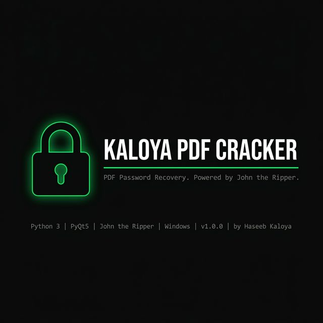
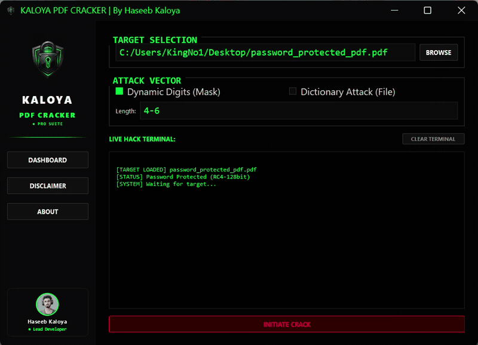
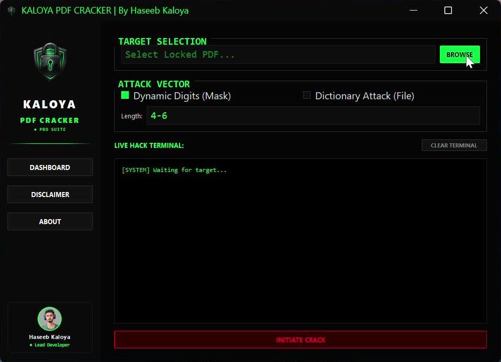
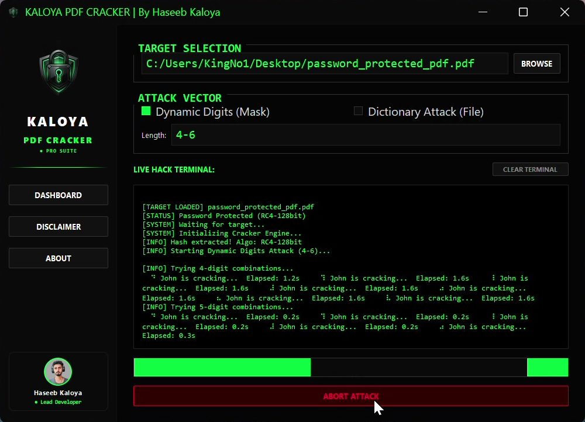
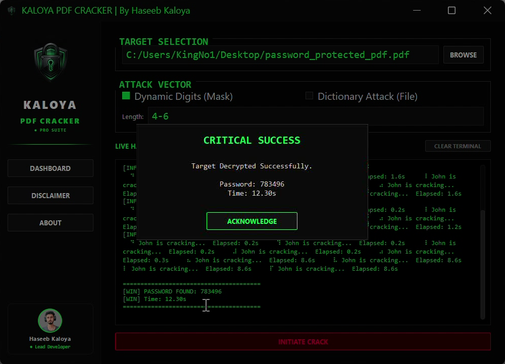
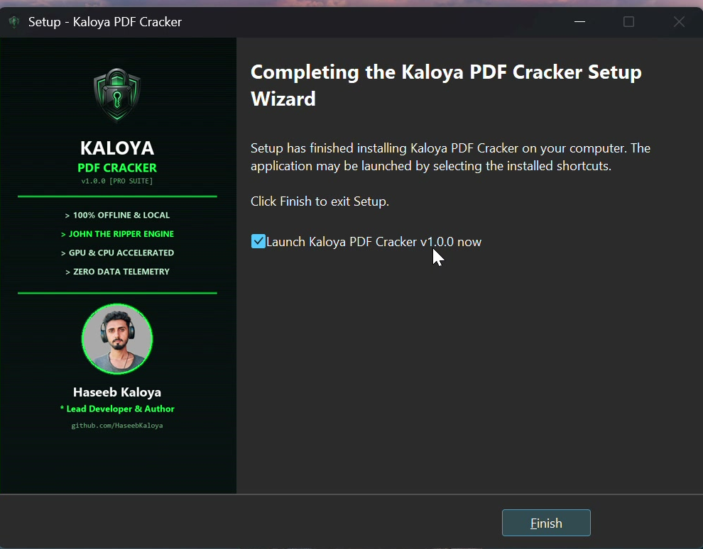
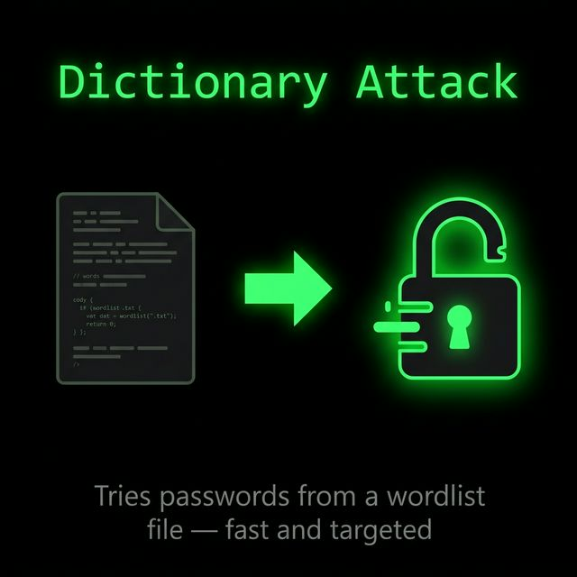
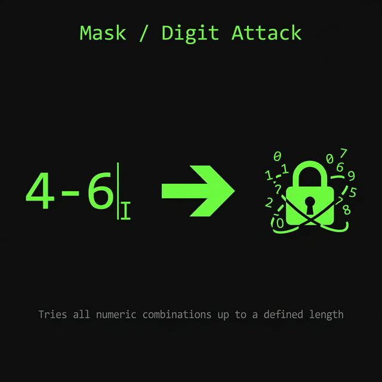

<div align="center">



[](https://github.com/HaseebKaloya/Kaloya-Pdf-Cracker/releases)
[](https://www.python.org)
[](LICENSE)
[](https://github.com/HaseebKaloya/Kaloya-Pdf-Cracker/releases)
[](https://www.youtube.com/watch?v=jiOTzxj-Qvw)
[](https://github.com/HaseebKaloya/Kaloya-Pdf-Cracker/wiki)
[](https://github.com/HaseebKaloya/Kaloya-Pdf-Cracker/stargazers)

</div>

---

## Overview

Kaloya PDF Cracker is a professional-grade PDF password recovery tool for Windows. It provides two distinct attack modes — dictionary-based and numeric mask — through a purpose-built graphical interface that stays responsive throughout the entire cracking process.

The tool does not implement its own cryptographic engine. Instead, it wraps **John the Ripper**, a well-established open-source password security auditing tool, so every attack runs at native binary speed. PDF hash extraction is handled by the **pyhanko** library, which reliably reads the encryption metadata from standard and legacy PDF security handlers.

This is not a script. It is a deployable desktop application, built for Windows, distributed with a proper installer and no external dependencies required.

---

## 🎬 Video Walkthrough & Live Demonstration

<div align="center">

[](https://www.youtube.com/watch?v=jiOTzxj-Qvw)

[](https://www.youtube.com/watch?v=jiOTzxj-Qvw)
[](https://youtube.com/@haseeb.kaloya)

<p>
  <b>⚡ Click the preview player above to watch the full step-by-step walkthrough in 1080p Full HD on YouTube!</b><br>
  <i>Covers legal disclaimer, Zero-UAC installation, RC4-128 hash extraction, multi-core AVX2 cracking, and instant document decryption.</i>
</p>

</div>

---

## Demo

<div align="center">
  
  <p><i>Live demonstration: Decrypting an RC4-128 protected PDF in seconds using the Dynamic Digits mask engine.</i></p>
</div>

---

## Interface Showcase

| Primary Dashboard (Idle State) | Active Execution & Telemetry |
|:---:|:---:|
|  |  |
| *Air-gapped target selection and attack configuration* | *Real-time candidate iteration and non-blocking worker thread* |

| Cryptographic Recovery Modal | High-DPI Modern Setup Wizard |
|:---:|:---:|
|  |  |
| *Instant plaintext extraction with cached potfile registry* | *Zero-UAC user-space installer with embedded cyber branding* |

---

## Features

| Feature | Details |
|---|---|
| Dictionary Attack | Supply any `.txt` wordlist; the engine tests each candidate at hardware speed |
| Mask / Digit Attack | Define a digit-length range (e.g. `4-6`); the tool iterates all numeric combinations |
| Automatic Hash Extraction | Reads the PDF encryption header directly, no manual hash preparation required |
| Algorithm Detection | Identifies and reports RC4-40, RC4-128, AES-128, or AES-256 encryption |
| Live Terminal Output | All backend activity streams in real time to the built-in GUI console |
| Non-blocking UI | The cracking engine runs in a dedicated thread; the interface stays fully interactive |
| Cross-generation JtR | Ships with AVX2, AVX, SSE4.1, SSE2, and generic JtR builds; best binary selected automatically |
| Abort Control | The "ABORT ATTACK" button terminates the backend cleanly at any point |
| Windows Integration | Dark title bar, custom application icon, Start Menu and Desktop shortcuts via installer |

---

## Requirements

| Requirement | Minimum |
|---|---|
| Operating System | Windows 10 (64-bit) or Windows 11 |
| Python | 3.9 or later (only for "run from source") |
| Disk Space | ~120 MB (installed) |
| RAM | 512 MB available |
| Dependencies | PyQt5, pyhanko (run from source only) |

---

## Installation

### Option A — Download the Installer (Recommended)

1. Go to the [Releases page](https://github.com/HaseebKaloya/Kaloya-Pdf-Cracker/releases).
2. Download **`KaloyaPDFCracker_Setup_v1.0.0.exe`**.
3. Run the installer and follow the setup wizard.
4. Launch **Kaloya PDF Cracker** from the Desktop or Start Menu.

No Python installation required. All dependencies are bundled.

---

### Option B — Run from Source

**Prerequisites:** Python 3.9+, pip

```powershell
# 1. Clone the repository
git clone https://github.com/HaseebKaloya/Kaloya-Pdf-Cracker.git
cd kaloya-pdf-cracker

# 2. Install dependencies
pip install PyQt5 pyhanko

# 3. Launch the application
python main.py
```

---

## Usage

### Step 1 — Select a Target

Click **BROWSE** in the *Target Selection* panel and choose a password-protected PDF file.

### Step 2 — Choose an Attack Mode

**Dictionary Attack**

Select **Dictionary Attack (File)**, then browse for a wordlist (`.txt` file, one password per line). This method is effective when the password is a common word or phrase.

```
Example wordlist path: C:\wordlists\rockyou.txt
```

**Digit / Mask Attack**

Select **Dynamic Digits (Mask)**, then enter a length or range in the *Length* field.

```
Single length:  6        (tries all 6-digit numbers: 000000 to 999999)
Range:          4-6      (tries all 4-digit, then 5-digit, then 6-digit numbers)
```

### Step 3 — Initiate the Attack

Click **INITIATE CRACK**. The button changes to **ABORT ATTACK** and the backend starts immediately. Output streams to the terminal area in real time.

### Step 4 — Review the Result

If the password is found, a popup displays the plaintext password and the time taken. Click **ACKNOWLEDGE** to dismiss. The result is also written to a `result.txt` file in the application directory.

If the attack is exhausted without a result, the panel reports failure along with the total time elapsed.

---

## Attack Modes — Explained

### Dictionary Attack



The dictionary engine passes a wordlist directly to John the Ripper via the `--wordlist` flag. John reads and tests each line against the PDF hash at native speed. This approach is the fastest route to success when the password is a proper word, phrase, or known leaked credential.

Recommended public wordlists: `rockyou.txt` (~14M entries), `SecLists` collections, or domain-specific lists.

### Mask / Digit Attack



The mask engine uses John the Ripper's `--mask=?d?d...` feature to systematically enumerate all numeric combinations up to the specified digit length. A range of `4-6` runs three sequential sub-attacks: all 4-digit, all 5-digit, and all 6-digit PINs. The current digit length is reported in the terminal on each transition.

---

## File Structure

```
kaloya-pdf-cracker/
├── main.py                     # Application entry point & Qt event loop
├── cracker.py                  # Cryptographic engine, JtR wrapper & Linux resolver
├── requirements.txt            # Python dependencies (PyQt5, pyHanko, Cryptography)
├── uac_manifest.xml            # Windows asInvoker non-admin execution manifest
├── build.spec                  # PyInstaller standalone configuration
├── build.bat                   # Automated compilation script for Windows
├── DISCLAIMER.txt              # Security, legal, and compliance notices
├── LICENSE                     # MIT License
│
├── gui/                        # Tactical Cyberpunk GUI Frontend
│   ├── main_window.py          # MainWindow, navigation, and custom popup modals
│   ├── worker.py               # Background QThread worker for non-blocking UI
│   ├── styles.qss              # Custom dark-theme Qt stylesheet & neon accents
│   ├── logo.ico                # Multi-resolution application icon (16px to 256px)
│   ├── logo.png                # Transparent high-resolution cyber shield emblem
│   └── HaseebKaloya.jpg        # Author avatar for developer profile card
│
├── john/                       # Embedded Password Auditing Core
│   └── run/                    # Pre-compiled multi-architecture binaries & potfile
│
├── installer/                  # Inno Setup Packaging
│   ├── setup.iss               # Inno Setup 6 compilation script (lowest privileges)
│   ├── wizard_sidebar.bmp      # Ultra-HD 480x920 Modern Dark sidebar artwork
│   ├── wizard_sidebar.png      # Portable sidebar source image
│   ├── wizard_header.bmp       # High-DPI 147x147 setup header emblem
│   └── wizard_header.png       # Portable header source image
│
├── docs/                       # Project Documentation & Assets
│   ├── TECHNICAL.md            # Deep-dive architecture and hashing mechanics
│   ├── WORDLIST_GUIDE.md       # Public dictionary recommendations and sourcing
│   ├── images/                 # Hero banners, diagrams, and demo.gif
│   │   ├── hero_banner.png     # Repository hero presentation banner
│   │   ├── demo.gif            # 1.37 MB optimized animated attack walkthrough
│   │   ├── feature_digits.png  # Dynamic Digits vector illustration
│   │   └── feature_wordlist.png# Dictionary attack vector illustration
│   └── screenshots/            # Pixel-perfect application window captures
│       ├── 01_dashboard_idle.png    # Primary dashboard in standby
│       ├── 02_cracking_active.png   # Active cracking terminal and progress
│       ├── 03_cracking_success.png  # Critical success recovery popup
│       └── 04_setup_wizard.png      # Modern dark installer wizard
│
└── wiki/                       # Official GitHub Wiki Documentation Suite
    ├── Home.md                 # Knowledge base home and architectural principles
    ├── Installation-and-Setup.md # Standalone distribution and source setup
    ├── Usage-and-Attack-Vectors.md # Complete operational manual and attack vectors
    ├── Linux-Guide.md          # Linux engine resolution and package provisioning
    ├── Troubleshooting-and-FAQ.md # Diagnostic solutions, AV heuristics, and FAQ
    ├── _Sidebar.md             # GitHub Wiki sidebar navigation hierarchy
    └── _Footer.md              # Documentation copyright and author footer
```

---

## Documentation and Wiki

Comprehensive technical manuals, attack vector specifications, Linux deployment details, and diagnostics are published in the official **[GitHub Wiki](https://github.com/HaseebKaloya/Kaloya-Pdf-Cracker/wiki)**:

- **[Wiki Home](wiki/Home.md)**: Technical overview, architectural principles, and quick-start instructions.
- **[Installation and Setup](wiki/Installation-and-Setup.md)**: Standalone Windows installer and environment configuration.
- **[Usage and Attack Vectors](wiki/Usage-and-Attack-Vectors.md)**: Detailed analysis of Dynamic Digits and Dictionary attack modes.
- **[Linux Platform Guide](wiki/Linux-Guide.md)**: Runtime architecture, engine resolution, and automated package management.
- **[Troubleshooting and FAQ](wiki/Troubleshooting-and-FAQ.md)**: Diagnostic solutions, heuristic scanner notices, and FAQs.

---

## Known Limitations

- **Numeric masks only (GUI).** The GUI exposes digit-only brute-force. For alpha or custom masks, run `cracker.py` directly from the command line with the `--wordlist` or `--digits` flag.
- **PDF revision 6 (AES-256-R6).** John the Ripper's PDF format supports this revision, but performance is significantly slower than RC4 or AES-128 due to the high key derivation cost.

---

## Roadmap

| Feature | Status |
|---|---|
| Native Linux Support (Runtime Auto-Install) | Completed |
| Zero-UAC Standard User Installer (`asInvoker`) | Completed |
| High-DPI Modern Dark Installer Artwork | Completed |
| Alpha/alphanumeric mask support via GUI | Planned |
| Progress percentage and estimated time remaining | Planned |
| Multi-PDF batch mode | Under consideration |
| GPU acceleration (OpenCL build) | Under consideration |


---

## License

This project is licensed under the MIT License. See [LICENSE](LICENSE) for details.

The bundled John the Ripper binaries are distributed under their own license. See [john/README.md](john/README.md) for the upstream project information.

---

## Contact

**Developer:** Haseeb Kaloya
**Email:** contact.haseebkaloya@gmail.com
**GitHub:** [github.com/HaseebKaloya](https://github.com/HaseebKaloya)
